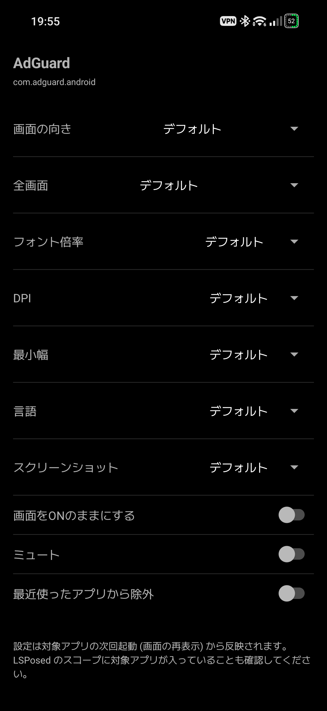
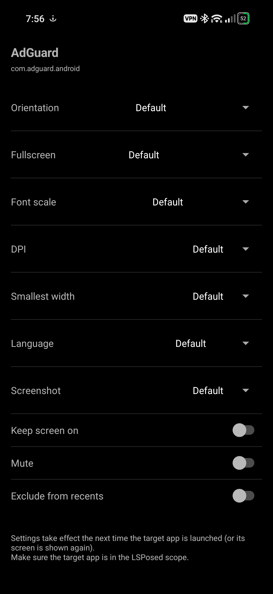

# Asrish v0.9.0

アプリごとに各種設定を変更する LSPosed モジュール。
「某モジュールっぽい」機能を、
**自分で選んだ範囲で、動く機能から1つずつ新規実装**する方針の第1弾 (土台)。

## ライセンス・出典
- 機能セットの原典は rovo89 の App Settings と、その
  Apache License 2.0 フォークである BlueCat300 の
  App Settings Reborn。本プロジェクトはその機能を Android 14
  以降向けに新規実装したもので、原典のコードは含まない
- 依存ライブラリ: libxposed API (Apache License 2.0) を compileOnly、
  libxposed service (Apache License 2.0) を implementation で使用

## 機能 (全部アプリ別)
| 機能 | 選択肢 |
|---|---|
| 画面の向き | デフォルト / 縦固定 / 横固定 / 自動回転 (センサー) |
| 全画面 | デフォルト / 全画面にする / イマーシブ (バーを隠す) / 全画面にしない |
| フォント倍率 | デフォルト / 85%〜130% |
| DPI | デフォルト / 240〜640 |
| 最小幅 | デフォルト / 320〜800 |
| 言語 | デフォルト / 日本語 / English / 中文 (简体・繁體) / 한국어 / Español / Français / Deutsch / Русский / العربية |
| スクリーンショット | デフォルト / 許可する (FLAG_SECURE を外す) / 禁止する |
| 画面ON維持 | ON / OFF |
| ミュート | ON / OFF (MediaPlayer / AudioTrack / SoundPool / ToneGenerator。ネイティブ再生は対象外) |
| 最近使ったアプリから除外 | ON / OFF |

いずれも Android の公開 API の範囲で実装しています。OS の内部実装を
フックしていないため、OS のバージョンアップで壊れにくい設計です。

## 動作環境
- Android 8.1 以降 (minSdk 27)。※全画面機能は Android 11 以降が必要
- LSPosed (Modern Xposed API 102 対応のもの)
- 作者環境では HyperOS 3 (Android 16) で全機能の動作を確認済み

## 使い方
1. Release から APK をインストール
2. LSPosed でモジュールを有効化し、設定したいアプリをスコープに
   入れる (端末を再起動)
3. Asrish を開き、アプリ一覧から対象アプリを選んで設定する
4. 設定は対象アプリの次回起動 (画面の再表示) から反映される

## スクリーンショット
アプリ別設定画面 (左: 日本語 / 右: 英語)

## v0.9.0 の変更点
- **最近使ったアプリから除外を追加** (アプリ別、スイッチ): 公開 API の
  ActivityManager.AppTask.setExcludeFromRecents で、対象アプリの
  タスクを履歴 (最近使ったアプリ) に表示しないようにする

## v0.8.0 の変更点
- **最小幅を追加** (アプリ別): デフォルト / 320〜800。対象アプリの
  Resources の Configuration.smallestScreenWidthDp を書き換える
  標準 API 方式で、sw<N>dp 修飾子のリソース選択に効く (実際の
  画面サイズや DPI は変わらない)。フォント倍率・DPI・言語と
  1 回の更新でまとめて適用する

## v0.7.0 の変更点
- **言語 (ロケール) を追加** (アプリ別): システム言語とは別に、
  アプリごとに表示言語を切り替える。同じ Configuration 書き換えで
  locales を差し替え、プロセスのデフォルトロケールも合わせる。
  対象アプリにその言語のリソースが含まれていない場合は表示は
  変わらない (Play の分割 APK 配信では言語リソースが別分割に
  なることがある)

## v0.6.1 の変更点
- GitHub 公開準備: LICENSE (Apache-2.0) を追加、README に機能一覧・
  動作環境・使い方と英語セクションを追加、モジュール説明文を
  現在の機能に合わせて更新。機能の変更はなし

## v0.6.0 の変更点
- **ミュートを追加** (アプリ別、スイッチ): 対象アプリの
  MediaPlayer / AudioTrack / SoundPool の音量指定を 0 に
  差し替え、再生開始時にも音量 0 を先に設定する。ToneGenerator は
  コンストラクタの音量引数を 0 に差し替える。いずれも公開 API の
  範囲で実装。ネイティブ再生 (AAudio / OpenSL 等、ゲームや
  ブラウザ内蔵エンジンなど) は Java 層を通らないため対象外

## v0.5.0 の変更点
- **DPI を追加** (アプリ別): デフォルト / 240〜640 (40刻み)。
  対象アプリの Resources の Configuration.densityDpi と
  DisplayMetrics の density を書き換える標準 API 方式。
  フォント倍率と 1 回の更新でまとめて適用し、scaledDensity も
  整合させる (両方設定したときに片方が上書きされるのを防ぐ)

## v0.4.1 の変更点
- アプリ別設定画面のレイアウトを変更: 設定名を左詰め、操作項目
  (スピナー / スイッチ) を右詰めにして同じ行に表示。行の間に
  区切り線を追加。スクリーンショットの選択肢は行に収まる短い
  表記 (デフォルト / 許可する / 禁止する) に変更
- システム言語に追従 (日本語 / 英語): UI 文字列をリソース化し、
  values (日本語) と values-en (英語) を用意。LSPosed の
  モジュール説明文も英語版を追加

## v0.4.0 の変更点
- **フォント倍率を追加** (アプリ別): デフォルト / 85% / 90% / 95% /
  100% / 105% / 110% / 115% / 130%。対象アプリの Resources の
  Configuration.fontScale を書き換える標準 API 方式で、
  Application.attach 直後と Activity.onCreate 直前 (レイアウト
  展開前) に適用し、onResume でも現在値と違う場合だけ再適用する

## v0.3.1 の変更点
- **スクリーンショット制御を復活** (アプリ別): デフォルト /
  許可する (FLAG_SECURE を外す) / 禁止する (FLAG_SECURE を付ける)。
  v0.2.0 で動かなかった原因はフックではなく設定の受け渡し
  (ContentProvider) が対象アプリから読めなかったことで、
  v0.3.0 の Remote Preferences 移行で解消したため再実装した。
  「許可する」は Window.setFlags / addFlags / setAttributes の
  横取りで対象アプリ自身が立てる FLAG_SECURE を無効化する

## 今後の予定
現在の機能範囲で公開し、不具合報告を見ながら対応を検討します。
機能追加の予定は未定です (候補: 通知制御 / ロック画面の
上に表示 / 常駐)。

---

# Asrish (English)

An LSPosed module to change various settings per app.
This is the first step of a project to re-implement features "in the
style of a certain well-known module" from scratch — one working
feature at a time, within a self-chosen scope.

## License & attribution
- The feature set originates from App Settings by rovo89 and its
  Apache License 2.0 fork, App Settings Reborn by BlueCat300.
  This project is a fresh implementation of those features for
  Android 14 and later, and contains none of their code
- Dependencies: libxposed API (Apache License 2.0) as compileOnly,
  libxposed service (Apache License 2.0) as implementation

## Features (all per-app)
| Feature | Options |
|---|---|
| Orientation | Default / Portrait / Landscape / Auto-rotate (sensor) |
| Fullscreen | Default / Force fullscreen / Immersive (hide bars) / Prevent fullscreen |
| Font scale | Default / 85%–130% |
| DPI | Default / 240–640 |
| Smallest width | Default / 320–800 |
| Language | Default / Japanese / English / Chinese (Simplified, Traditional) / Korean / Spanish / French / German / Russian / Arabic |
| Screenshot | Default / Allow (removes FLAG_SECURE) / Block |
| Keep screen on | On / Off |
| Mute | On / Off (MediaPlayer / AudioTrack / SoundPool / ToneGenerator; native playback is out of scope) |
| Exclude from recents | On / Off |

All features are implemented using only public Android APIs. Nothing
hooks OS internals, so the module is designed to keep working across
OS updates.

## Requirements
- Android 8.1 or later (minSdk 27). The fullscreen feature requires Android 11 or later
- LSPosed (with Modern Xposed API 102 support)
- All features verified by the author on HyperOS 3 (Android 16)

## Usage
1. Install the APK from Releases
2. Enable the module in LSPosed and add the apps you want to
   configure to the scope (then reboot)
3. Open Asrish, pick an app from the list, and configure it
4. Settings take effect the next time the target app is launched
   (or its screen is shown again)

## Screenshots
The per-app settings screen (left: Japanese / right: English)

## Changes in v0.9.0
- **Added exclude from recents** (per-app, switch): uses the
  public ActivityManager.AppTask.setExcludeFromRecents API to
  keep the target app's tasks out of the recents screen

## Changes in v0.8.0
- **Added smallest width** (per-app): Default / 320–800.
  Rewrites Configuration.smallestScreenWidthDp of the target
  app's Resources using standard APIs, which affects sw<N>dp
  resource selection (the actual screen size and DPI do not
  change). Applied together with font scale, DPI and language
  in a single update

## Changes in v0.7.0
- **Added language (locale)** (per-app): switches the display
  language per app, independently of the system language.
  Rewrites the Configuration locales with the same mechanism
  and also sets the process default locale. If the target app
  does not contain resources for that language, the display
  does not change (with Play split APK delivery, language
  resources may be in a separate split)

## Changes in v0.6.1
- GitHub release preparation: added the LICENSE (Apache-2.0),
  added the feature list, requirements, usage and an English
  section to the README, and updated the module description to
  match the current features. No functional changes

## Changes in v0.6.0
- **Added mute** (per-app, switch): replaces the volume arguments
  of the target app's MediaPlayer / AudioTrack / SoundPool with 0,
  and sets the volume to 0 before playback starts. For
  ToneGenerator, the constructor's volume argument is replaced
  with 0. All within public APIs. Native playback (AAudio /
  OpenSL etc., such as games and built-in browser engines) does
  not pass through the Java layer and is out of scope

## Changes in v0.5.0
- **Added DPI** (per-app): Default / 240–640 (in steps of 40).
  Rewrites Configuration.densityDpi and the DisplayMetrics
  density of the target app's Resources using standard APIs.
  Applied together with font scale in a single update, keeping
  scaledDensity consistent (so the two settings do not overwrite
  each other)

## Changes in v0.4.1
- Changed the per-app settings screen layout: setting names are
  left-aligned and controls (spinners / switches) right-aligned
  on the same row, with dividers between rows. The screenshot
  options were shortened to fit the row (Default / Allow / Block)
- The UI follows the system language (Japanese / English): all
  UI strings were moved to resources, with values (Japanese) and
  values-en (English). The LSPosed module description also
  gained an English version

## Changes in v0.4.0
- **Added font scale** (per-app): Default / 85% / 90% / 95% /
  100% / 105% / 110% / 115% / 130%. Rewrites
  Configuration.fontScale of the target app's Resources using
  standard APIs, applied right after Application.attach and just
  before Activity.onCreate (before layout inflation), and
  re-applied onResume only when the value differs

## Changes in v0.3.1
- **Restored screenshot control** (per-app): Default / Allow
  (removes FLAG_SECURE) / Block (sets FLAG_SECURE). The reason
  it did not work in v0.2.0 was not the hook but the config
  transport (ContentProvider) being unreadable from target apps;
  the move to Remote Preferences in v0.3.0 fixed that, so the
  feature was re-implemented. "Allow" works by intercepting
  Window.setFlags / addFlags / setAttributes to neutralize the
  FLAG_SECURE that the target app sets itself

## Future plans
The module is published with the current feature set; further
work will be considered based on bug reports. No feature
additions are currently planned (candidates: notification
control / show on lock screen / resident).
