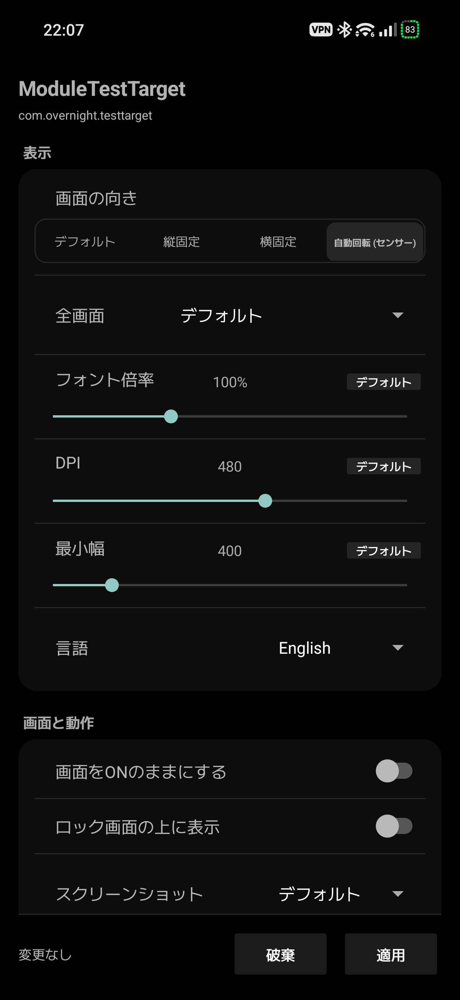

# Asrish v0.10.9

日本語 | [English](#asrish-english)

アプリごとに各種設定を変更するLSPosedモジュール。
某モジュールっぽい機能を、**自分で選んだ範囲で、
動く機能から1つずつ新規実装**する方針

XDA スレッド: https://xdaforums.com/t/module-lsposed-asrish-per-app-orientation-fullscreen-font-scale-dpi-screenshot-control-keep-screen-on-mute.4808335/

## お知らせ: パッケージ名を変更しました

LSPosed Modules Repo への登録に向け、v0.10.7 でパッケージ名を
`com.overnight.asrish` から `io.github.otouotouotou.asrish` に変更
しました。パッケージ名が変わると別アプリ扱いになり、設定は自動では
引き継がれません。

旧バージョンからの移行は、v0.10.5で追加した設定ファイルの
書き出し / 読み込みを使ってください:

1. 旧バージョン (com.overnight.asrish) で設定を「書き出し」しておく
2. 本バージョンをインストール
3. LSPosed でモジュールを有効化し、対象アプリをスコープに入れる
4. Asrish を開いて「読み込み」で、書き出しておいたファイルを選ぶ
5. 旧バージョンをアンインストール
6. 再起動

## 免責事項
使用は自己責任でお願いします。
本モジュールの使用によって生じた不具合・損害に
ついて、作者は責任を負いません。

## ライセンス・出典
- 機能セットの原典はrovo89のApp Settingsと、その
  Apache License 2.0 フォークであるBlueCat300の
  App Settings Reborn。本プロジェクトはその機能をAndroid 11
  以降向けに新規実装したもので、原典のコードは含みません
- 依存ライブラリ: libxposed API (Apache License 2.0)をcompileOnly、
  libxposed service(Apache License 2.0)をimplementation で使用

## 機能 (全部アプリ別)
| 機能 | 選択肢 |
|---|---|
| 画面の向き | デフォルト / 縦固定 / 横固定 / 自動回転 (センサー) / 縦固定 (逆) / 横固定 (逆) / 縦センサー / 横センサー |
| 全画面 | デフォルト / 全画面にする / イマーシブ (バーを隠す) / 全画面にしない |
| フォント倍率 | デフォルト / 85%〜130% |
| DPI | デフォルト / 240〜640 |
| 最小幅 | デフォルト / 320〜800 |
| 言語 | デフォルト / 日本語 / English / 中文 (简体・繁體) / 한국어 / Español / Français / Deutsch / Русский / العربية |
| レイアウト方向の固定 | デフォルト / LTR に固定 (言語が RTL のとき、方向だけ LTR に固定する) |
| スクリーンショット | デフォルト / 許可する (FLAG_SECURE を外す) / 禁止する |
| 画面ON維持 | デフォルト / 強制ON / 強制OFF |
| ロック画面の上に表示 | デフォルト / 強制ON / 強制OFF |
| ミュート | ON / OFF (MediaPlayer / AudioTrack / SoundPool / ToneGenerator。ネイティブ再生は対象外) |
| 最近使ったアプリから除外 | ON / OFF |
| 継続通知 | デフォルト / 継続にする / 継続にしない |
| 通知を繰り返す | デフォルト / 強制ON / 強制OFF (気づくまで音・バイブを繰り返す) |
| 通知をミュート | ON / OFF |
| クリップボードの読み取りをブロック | ON / OFF (そのアプリ自身がコピーした内容は読める) |

※ 縦センサーの 180° 反転は、端末の「すべての回転を許可」
(allowAllRotations) が有効な場合のみ働きます。HyperOS3は
デフォルト無効のため反転しませんが、HyperCeiler の
「画面の回転」か、[AllowAllRotations](https://github.com/otouotouotou/AllowAllRotations) で回避できます。
有効かどうかは機種・ROM 依存のため、Asrish 側では対応しません。

いずれもAndroidの公開APIの範囲で実装しています。OSの内部実装を
フックしていないため、OSのバージョンアップで壊れにくい設計です。

## 動作環境
- Android 11 以降
- LSPosed (Modern Xposed API 102対応のもの)
- 作者環境では Xiaomi 17 Ultra HyperOS3(Android 16) 、Oneplus 7 OOS11(Android11)で動作を確認済み (HyperOS 3 では縦センサーは機能しませんが、[AllowAllRotations](https://github.com/otouotouotou/AllowAllRotations) で回避できます)

## 使い方
1. ReleaseからAPKをインストール
2. LSPosedでモジュールを有効化し、設定したいアプリをスコープに
   入れる (端末を再起動)
3. Asrish を開き、アプリ一覧から対象アプリを選んで設定し、適用を押す
4. 適用した設定は対象アプリの次回起動 (画面の再表示) から反映される

## うまく動かないとき
アプリによっては、フォントやロケールなどをアプリ側が独自に処理
していて、Asrish の設定が効かない場合があります。切り分けには
動作確認用の [ModuleTestTarget](https://github.com/otouotouotou/ModuleTestTarget)
が使えます。スコープに ModuleTestTarget を入れて同じ設定を
試して、そちらで効けばアプリ起因、効かなければ端末・環境起因の
可能性が高いです。

## スクリーンショット
アプリ別設定画面 (左: 日本語 / 右: 英語)

## v0.10.9 の変更点
- **画面の向きに 4 項目を追加** (GitHub Issue #1 の要望対応):
  縦固定 (逆)、横固定 (逆)、縦センサー、横センサー。
  いずれも標準 API (SCREEN_ORIENTATION_*) の追加。
  ※ 縦センサーには端末側の条件があります (注記参照)
- **「強制OFF」を 3 項目に追加**: 通知を繰り返す、画面ON維持、
  ロック画面の上に表示が、デフォルト / 強制ON / 強制OFF の
  3 択になった。アプリ自身が後から立てるフラグや表示要求も
  打ち消す
- **新アイコン**: 金の魔法のランプ (紺背景)
- レイアウト方向の固定はデフォルト / LTR に固定のみ
  (RTL 固定は試験の結果、実レイアウトが反転しなかったため
  不採用)

## v0.10.7 の変更点
- **パッケージ名を変更** (お知らせ参照):
  com.overnight.asrish → io.github.otouotouotou.asrish。
  設定は書き出し / 読み込みで移行できる
- **通知の設定を追加** (アプリ別、設定画面に「通知」グループ):
  継続通知 (デフォルト / 継続にする / 継続にしない)、通知を
  繰り返す、通知をミュート。NotificationManager.notify を
  横取りして Notification オブジェクトを書き換える方式で、
  設定は投稿ごとに読むため対象アプリの再起動は不要。
  ミュートは Android 11 以降の前提に合わせ、通知チャンネルの
  登録時にも音・バイブを消す (登録済みのチャンネルは音を
  変更できない仕様のため、新規に作られるチャンネルから有効)
- **クリップボードの読み取りをブロックを追加**
  アプリがクリップボードを読むと空白を返す。ただしその
  アプリ自身がコピーした内容は、内容の指紋照合で判別して
  読めるようにしている (アプリ内のコピー＆貼り付けを
  壊さないため)。対象は前面にいる間の読み取り

## v0.10.5 の変更点
- **レイアウト方向をLTRに固定を追加** (アプリ別、スイッチ): 言語が
  RTL (アラビア語など) のアプリで、言語はそのままにレイアウトの
  向きだけをLTRに固定する。公開APIの範囲
  (Configuration のレイアウト方向の上書き) で実装
- メイン画面の整理: 説明文を削除し、書き出し / 読み込みの上に
  「設定ファイル」の見出しを追加

## v0.10.4 の変更点
- **設定ファイルの書き出し / 読み込みを追加**: メイン画面の
  「書き出し」「読み込み」から、設定一式をJSONファイルに
  保存 / 復元できる (Storage Access Framework を使用)。
  パッケージ名変更時の移行用 (お知らせ参照)。読み込みは
  全置き換えで、確認ダイアログ付き
- 設定画面の説明文を修正

## v0.10.3 の変更点
- **アプリ別設定画面を刷新**: 項目をグループ (表示 / 画面と動作 /
  その他) ごとのカードにまとめ、変更は「適用」ボタンを押すまで
  保存されない方式に変更した (未適用の項目には ● が付く。
  「破棄」で適用済みの状態に戻せる)
- 操作部品も見直した: 画面の向きはセグメント、フォント倍率 /
  DPI / 最小幅はスライダー (数値は画面幅の中央に表示)、
  全画面 / 言語 / スクリーンショットはドロップダウン。
  スライダー項目には項目別の「デフォルト」ボタンを付けた
- フォント倍率は 85%〜130% を 5% 刻みで選べるようになった
  (120% / 125% を追加)。DPIと最小幅は10刻みになった

## v0.10.0 の変更点
- **ロック画面の上に表示を追加** (アプリ別、スイッチ): 公開 API の
  Activity.setShowWhenLocked で、対象アプリをロック画面の上に
  表示する
- Android 11未満では、全画面の設定行をグレーアウトして選べない
  ようにした (全画面は Android 11以降が必要なため)

## v0.9.1 の変更点
- **設定 UI を 10 言語対応に**: 日本語 / 英語に加えて、中国語 (简体・繁體)、
  韓国語、スペイン語、フランス語、ドイツ語、ロシア語、アラビア語の
  文字列リソースを追加。言語機能で選べる言語と、設定 UI の対応言語が
  同じになった (翻訳は機械生成ベース。おかしいところがあれば
  Issue などで教えてください)

## v0.9.0 の変更点
- **最近使ったアプリから除外を追加** (アプリ別、スイッチ): 公開 API の
  ActivityManager.AppTask.setExcludeFromRecentsで、対象アプリの
  タスクを履歴 (最近使ったアプリ) に表示しないようにする

## v0.8.0 の変更点
- **最小幅を追加** (アプリ別): デフォルト / 320〜800。対象アプリの
  ResourcesのConfiguration.smallestScreenWidthDpを書き換える
  標準API方式で、sw<N>dp 修飾子のリソース選択に効く (実際の
  画面サイズやDPIは変わらない)。フォント倍率・DPI・言語と
  1 回の更新でまとめて適用する

## v0.7.0 の変更点
- **言語 (ロケール) を追加** (アプリ別): システム言語とは別に、
  アプリごとに表示言語を切り替える。同じConfiguration書き換えで
  localesを差し替え、プロセスのデフォルトロケールも合わせる。
  対象アプリにその言語のリソースが含まれていない場合は表示は
  変わらない (プレイストアの分割 APK 配信では言語リソースが別分割に
  なることがある)

## v0.6.1 の変更点
- GitHub 公開準備: LICENSE(Apache-2.0)を追加、READMEに機能一覧・
  動作環境・使い方と英語セクションを追加、モジュール説明文を
  現在の機能に合わせて更新。機能の変更はなし

## v0.6.0 の変更点
- **ミュートを追加** (アプリ別、スイッチ): 対象アプリの
  MediaPlayer / AudioTrack / SoundPool の音量指定を 0 に
  差し替え、再生開始時にも音量 0 を先に設定するToneGeneratorは
  コンストラクタの音量引数を 0 に差し替える。いずれも公開APIの
  範囲で実装。ネイティブ再生 (AAudio/OpenSL等、ゲームや
  ブラウザ内蔵エンジンなど) はJava層を通らないため対象外

## v0.5.0 の変更点
- **DPI を追加** (アプリ別): デフォルト / 240〜640 (40刻み)。
  対象アプリのResourcesのConfiguration.densityDpiと
  DisplayMetricsのdensityを書き換える標準API方式。
  フォント倍率と1回の更新でまとめて適用し、scaledDensityも
  整合させる (両方設定したときに片方が上書きされるのを防ぐ)

## v0.4.1 の変更点
- アプリ別設定画面のレイアウトを変更: 設定名を左詰め、操作項目
  (スピナー / スイッチ) を右詰めにして同じ行に表示。行の間に
  区切り線を追加。スクリーンショットの選択肢は行に収まる短い
  表記 (デフォルト / 許可する / 禁止する) に変更
- システム言語に追従 (日本語 / 英語): UI文字列をリソース化し、
  values (日本語) と values-en (英語) を用意。LSPosedの
  モジュール説明文も英語版を追加

## v0.4.0 の変更点
- **フォント倍率を追加** (アプリ別): デフォルト / 85% / 90% / 95% /
  100% / 105% / 110% / 115% / 130%。対象アプリのResources
  Configuration.fontScaleを書き換える標準API方式で、
  Application.attach直後とActivity.onCreate直前 (レイアウト
  展開前) に適用し、onResumeでも現在値と違う場合だけ再適用する

## v0.3.1 の変更点
- **スクリーンショット制御を復活** (アプリ別): デフォルト /
  許可する (FLAG_SECUREを外す) / 禁止する (FLAG_SECUREを付ける)。
  v0.2.0で動かなかった原因はフックではなく設定の受け渡し
  (ContentProvider)が対象アプリから読めなかったことで、
  v0.3.0のRemote Preferences移行で解消したため再実装した。
  「許可する」は Window.setFlags / addFlags / setAttributes の
  横取りで対象アプリ自身が立てる FLAG_SECUREを無効化する

## 今後の予定
現在の機能範囲で公開し、不具合報告を見ながら対応を検討します。
機能追加の予定は未定です (候補: 常駐)。

---

# Asrish (English)

[日本語](#asrish-v0109) | English

An LSPosed module to change various settings per app.
This is the first step of a project to re-implement features "in the
style of a certain well-known module" from scratch — one working
feature at a time, within a self-chosen scope.

XDA thread: https://xdaforums.com/t/module-lsposed-asrish-per-app-orientation-fullscreen-font-scale-dpi-screenshot-control-keep-screen-on-mute.4808335/

## Notice: the package name has changed

For registration in the LSPosed Modules Repo, v0.10.7 changes the
package name from `com.overnight.asrish` to
`io.github.otouotouotou.asrish`. A different package name means a
different app, so settings will not carry over automatically.

To migrate from the old version, use the settings export / import
added in v0.10.5:

1. In the old version (com.overnight.asrish), export your settings
2. Install this version
3. Enable the module in LSPosed and add your target apps to its scope
4. Open Asrish and use "Import" to load the exported file
5. Uninstall the old version
6. Reboot

## Disclaimer
This module is provided "as is", without any warranty. Use it
at your own risk. The author takes no responsibility for any
damage or malfunction caused by using this module.

## License & attribution
- The feature set originates from App Settings by rovo89 and its
  Apache License 2.0 fork, App Settings Reborn by BlueCat300.
  This project is a fresh implementation of those features for
  Android 11 and later, and contains none of their code
- Dependencies: libxposed API (Apache License 2.0) as compileOnly,
  libxposed service (Apache License 2.0) as implementation

## Features (all per-app)
| Feature | Options |
|---|---|
| Orientation | Default / Portrait / Landscape / Auto-rotate (sensor) / Reverse portrait / Reverse landscape / Sensor portrait / Sensor landscape |
| Fullscreen | Default / Force fullscreen / Immersive (hide bars) / Prevent fullscreen |
| Font scale | Default / 85%–130% |
| DPI | Default / 240–640 |
| Smallest width | Default / 320–800 |
| Language | Default / Japanese / English / Chinese (Simplified, Traditional) / Korean / Spanish / French / German / Russian / Arabic |
| Layout direction | Default / Force LTR (keeps the language, fixes the layout direction to LTR for RTL languages) |
| Screenshot | Default / Allow (removes FLAG_SECURE) / Block |
| Keep screen on | Default / Force on / Force off |
| Show on lock screen | Default / Force on / Force off |
| Mute | On / Off (MediaPlayer / AudioTrack / SoundPool / ToneGenerator; native playback is out of scope) |
| Exclude from recents | On / Off |
| Ongoing notifications | Default / Force ongoing / Prevent ongoing |
| Insistent notifications | Default / Force on / Force off (repeats the sound / vibration until noticed) |
| Mute notifications | On / Off |
| Block clipboard reads | On / Off (content the app copied itself stays readable) |

* Sensor portrait rotates to 180 degrees only when the device allows all rotations (allowAllRotations). HyperOS 3 has it off by default, so it does not rotate there; you can work around it with HyperCeiler's "Screen rotation" or with [AllowAllRotations](https://github.com/otouotouotou/AllowAllRotations). Whether this is available depends on the device / ROM, and Asrish does not handle it.

All features are implemented using only public Android APIs. Nothing
hooks OS internals, so the module is designed to keep working across
OS updates.

## Requirements
- Android 11 or later
- LSPosed (with Modern Xposed API 102 support)
- Verified by the author on Xiaomi 17 Ultra HyperOS3 (Android 16),Oneplus7 OOS11(Android 11)
- Note: sensor portrait flips to 180° only when the device allows all rotations (allowAllRotations). HyperOS 3 has it off by default; enabling HyperCeiler's "Screen rotation" makes it flip, or use my [AllowAllRotations](https://github.com/otouotouotou/AllowAllRotations) module. This depends on the device / ROM, and Asrish does not handle it

## Usage
1. Install the APK from Releases
2. Enable the module in LSPosed and add the apps you want to
   configure to the scope (then reboot)
3. Open Asrish, pick an app from the list, configure it, and tap "Apply"
4. Applied settings take effect the next time the target app is
   launched (or its screen is shown again)

## Troubleshooting
Some apps handle things like fonts and locale on their own, so
Asrish's settings may not take effect on them. To tell whether
the cause is the app or your device, try
[ModuleTestTarget](https://github.com/otouotouotou/ModuleTestTarget),
a small test app: scope it in LSPosed and apply the same
settings — if they work there, the cause is the target app;
if they don't, it's likely your device / environment.

## Screenshots
The per-app settings screen (left: Japanese / right: English)

## Changes in v0.10.9
- **Added 4 orientations** (requested in GitHub Issue #1):
  reverse portrait, reverse landscape, sensor portrait, and
  sensor landscape — standard APIs only
  (SCREEN_ORIENTATION_*). Note: sensor portrait depends on
  a device-side setting (see the note under Requirements)
- **Added "Force off" to 3 settings**: insistent
  notifications, keep screen on, and show on lock screen
  are now Default / Force on / Force off. Flags and
  requests the app sets itself afterwards are overridden
  too
- **New icon**: a gold magic lamp on navy
- Layout direction stays Default / Force LTR only
  (Force RTL was tried, but the actual layout did not
  flip, so it was dropped)

## Changes in v0.10.7
- **Package name changed** (see the notice above):
  com.overnight.asrish → io.github.otouotouotou.asrish.
  Settings can be migrated with export / import
- **Added notification settings** (per-app, a new "Notifications"
  group on the settings screen): ongoing notifications (Default /
  Force ongoing / Prevent ongoing), insistent notifications, and
  mute notifications. Implemented by intercepting
  NotificationManager.notify and rewriting the Notification
  object; settings are read on every post, so the target app does
  not need a restart. For Android 11 and later, mute also removes
  the sound and vibration when a notification channel is created
  (a registered channel's sound cannot be changed afterwards, so
  this takes effect for newly created channels)
- **Added "Block clipboard reads"** (per-app, an Asrish-original
  feature): an app with this ON sees an empty clipboard. Content
  the app copied itself stays readable, matched by a fingerprint
  of the clip, so copy & paste inside the app keeps working.
  Covers reads while the app is in the foreground

## Changes in v0.10.5
- **Added "Force layout direction to LTR"** (per-app switch): for
  apps in an RTL language (such as Arabic), this keeps the language
  as-is and fixes only the layout direction to LTR. Implemented
  with public APIs only (overriding the layout direction in the
  app's Configuration)
- Tidied the main screen: removed the description text and added a
  "Settings file" heading above Export / Import

## Changes in v0.10.4
- **Added settings export / import**: from "Export" / "Import" on
  the main screen, all settings can be saved to and restored from
  a JSON file (via the Storage Access Framework). Intended for the
  package name change migration (see the notice above). Import
  replaces everything and asks for confirmation first
- Fixed the description text on the settings screen

## Changes in v0.10.3
- **Redesigned the per-app settings screen**: items are now
  grouped into cards (Display / Screen & behavior / Other), and
  changes are only saved when you tap "Apply" (changed items
  are marked with ●, and "Discard" reverts them)
- The controls were reworked too: orientation is a segmented
  control, font scale / DPI / smallest width are sliders (the
  value is shown at the center of the screen width), and
  fullscreen / language / screenshot are dropdowns. Slider
  items have a per-item "Default" button
- Font scale can now be set in 5% steps from 85% to 130%
  (120% and 125% added). DPI and smallest width now step by 10

## Changes in v0.10.0
- **Added show on lock screen** (per-app, switch): shows the
  target app over the lock screen, using the public
  Activity.setShowWhenLocked API
- On Android versions below 11, the fullscreen settings row is
  greyed out and cannot be selected (fullscreen requires
  Android 11 or later)

## Changes in v0.9.1
- **The settings UI is now available in 10 languages**: added
  string resources for Chinese (Simplified and Traditional),
  Korean, Spanish, French, German, Russian and Arabic, on top of
  Japanese and English - the same set of languages the Language
  feature offers. The translations are machine-generated; please
  report anything that reads oddly

## Changes in v0.9.0
- **Added exclude from recents** (per-app, switch): uses the
  public ActivityManager.AppTask.setExcludeFromRecents API to
  keep the target app's tasks out of the recents screen

## Changes in v0.8.0
- **Added smallest width** (per-app): Default / 320–800.
  Rewrites Configuration.smallestScreenWidthDp of the target
  app's Resources using standard APIs, which affects sw<N>dp
  resource selection (the actual screen size and DPI do not
  change). Applied together with font scale, DPI and language
  in a single update

## Changes in v0.7.0
- **Added language (locale)** (per-app): switches the display
  language per app, independently of the system language.
  Rewrites the Configuration locales with the same mechanism
  and also sets the process default locale. If the target app
  does not contain resources for that language, the display
  does not change (with Play split APK delivery, language
  resources may be in a separate split)

## Changes in v0.6.1
- GitHub release preparation: added the LICENSE (Apache-2.0),
  added the feature list, requirements, usage and an English
  section to the README, and updated the module description to
  match the current features. No functional changes

## Changes in v0.6.0
- **Added mute** (per-app, switch): replaces the volume arguments
  of the target app's MediaPlayer / AudioTrack / SoundPool with 0,
  and sets the volume to 0 before playback starts. For
  ToneGenerator, the constructor's volume argument is replaced
  with 0. All within public APIs. Native playback (AAudio /
  OpenSL etc., such as games and built-in browser engines) does
  not pass through the Java layer and is out of scope

## Changes in v0.5.0
- **Added DPI** (per-app): Default / 240–640 (in steps of 40).
  Rewrites Configuration.densityDpi and the DisplayMetrics
  density of the target app's Resources using standard APIs.
  Applied together with font scale in a single update, keeping
  scaledDensity consistent (so the two settings do not overwrite
  each other)

## Changes in v0.4.1
- Changed the per-app settings screen layout: setting names are
  left-aligned and controls (spinners / switches) right-aligned
  on the same row, with dividers between rows. The screenshot
  options were shortened to fit the row (Default / Allow / Block)
- The UI follows the system language (Japanese / English): all
  UI strings were moved to resources, with values (Japanese) and
  values-en (English). The LSPosed module description also
  gained an English version

## Changes in v0.4.0
- **Added font scale** (per-app): Default / 85% / 90% / 95% /
  100% / 105% / 110% / 115% / 130%. Rewrites
  Configuration.fontScale of the target app's Resources using
  standard APIs, applied right after Application.attach and just
  before Activity.onCreate (before layout inflation), and
  re-applied onResume only when the value differs

## Changes in v0.3.1
- **Restored screenshot control** (per-app): Default / Allow
  (removes FLAG_SECURE) / Block (sets FLAG_SECURE). The reason
  it did not work in v0.2.0 was not the hook but the config
  transport (ContentProvider) being unreadable from target apps;
  the move to Remote Preferences in v0.3.0 fixed that, so the
  feature was re-implemented. "Allow" works by intercepting
  Window.setFlags / addFlags / setAttributes to neutralize the
  FLAG_SECURE that the target app sets itself

## Future plans
The module is published with the current feature set; further
work will be considered based on bug reports. No feature
additions are currently planned (candidate: resident in memory).
